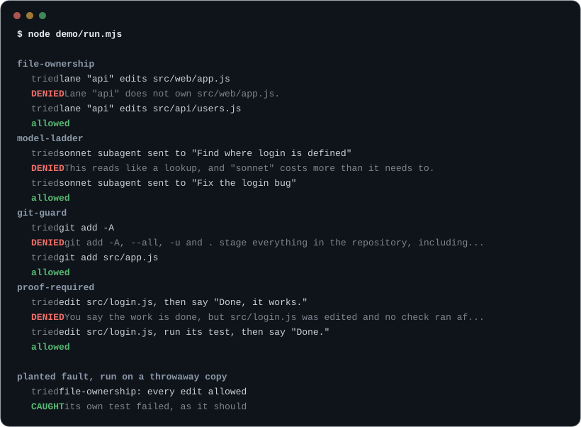

# agent-guardrails

   
[](https://github.com/zacharyoliver-ai/agent-guardrails/actions/workflows/ci.yml)

Hooks and command-line tools for running many AI coding agents at once, with a planted bug behind every guard to show it works.


## Why this exists

Run a few coding agents at once and the same three things go wrong. One burns through your budget while nobody's watching. Two of them edit the same file. And a test passes that could never have failed.

We build [Awnitboss](https://awnitboss.com), a production CRM, with AI agents running side by side every day. This repo is our way of working, rewritten from scratch as small tools anyone can use with Claude Code. [Results](docs/results.md) has the scale.

## See it run

```
git clone https://github.com/zacharyoliver-ai/agent-guardrails
node agent-guardrails/demo/run.mjs
```

It needs no Claude and no network. Each hook runs on sample input, and you see what the agent tried and what the guard did. The last scene breaks a guard on purpose, in a throwaway copy, and shows its own test catching it.



To see what the guards would have done over your own last week of sessions, run this. It installs nothing and writes nothing.

```
node bin/replay.mjs --since 7d
```

## What's inside

**Guards** run before a tool call and deny it with a reason the agent can act on.

| Tool | What it does |
| --- | --- |
| [step-budget](hooks/step-budget.mjs) | Counts tool calls per agent, warns once, then allows reads only. |
| [file-ownership](hooks/file-ownership.mjs) | Denies edits outside the files a lane owns. |
| [design-seat](hooks/design-seat.mjs) | Keeps a design agent to screen files, with no pushes or test runs. |
| [model-ladder](hooks/model-ladder.mjs) | Requires a model on every subagent call and matches it to the job. |
| [fleet-cap](hooks/fleet-cap.mjs) | Limits how many subagents run at once, with a lower cap for large models. |
| [foreground-wait](hooks/foreground-wait.mjs) | Sends full test runs and builds to the background. |
| [git-guard](hooks/git-guard.mjs) | Denies staging everything, forced pushes, pushes to main and risky deletes. |
| [secret-guard](hooks/secret-guard.mjs) | Blocks credentials written into files or printed from the environment. |
| [bulk-write-gate](hooks/bulk-write-gate.mjs) | Denies SQL that rewrites a protected table without a stated reason. |

**Stop hooks** run when an agent finishes, and send the reply back once if it breaks a rule.

| Tool | What it does |
| --- | --- |
| [never-say](hooks/never-say.mjs) | Sends back replies that contain a listed phrase, with what to write instead. |
| [proof-required](hooks/proof-required.mjs) | Sends back "done" when an edit has no check run after it. |
| [decision-ledger](hooks/decision-ledger.mjs) | Keeps every question put to a person on a list until answered. |
| [decisions-file](hooks/decisions-file.mjs) | Shows running sessions each change to the shared rulings file. |

**Proof tools** check that tests and promises mean something.

| Tool | What it does |
| --- | --- |
| [replay](bin/replay.mjs) | Counts what the guards would have denied in your past sessions. |
| [planted-fault](bin/planted-fault.mjs) | Breaks your code on purpose and checks that your test notices. |
| [proof-matrix](bin/proof-matrix.mjs) | Runs every planted fault in this repo in a throwaway copy. |
| [contract-check](bin/contract-check.mjs) | Marks a contract line proven only when its test fails on a broken copy. |
| [find-vacuous-tests](bin/find-vacuous-tests.mjs) | Lists tests that have no assertion or can never fail. |
| [pin-check](bin/pin-check.mjs) | Checks that pinned wording is intact and forbidden text is absent. |
| [plain-copy](bin/plain-copy.mjs) | Finds phrases that read as machine-written and suggests plain ones. |

**Cost and coordination** keep spend visible and lanes apart.

| Tool | What it does |
| --- | --- |
| [usage-report](bin/usage-report.mjs) | Reports token use per session and flags runaways. |
| [ci-minutes](bin/ci-minutes.mjs) | Paces CI minutes against the month's cap and its reserve. |
| [lane-board](bin/lane-board.mjs) | Shows which files each worktree is changing and where lanes overlap. |
| [setup](bin/setup.mjs) | Adds the hooks you pick to a project's Claude Code settings. |

**Agents and skills** come with the plugin.

| Tool | What it does |
| --- | --- |
| [scout](agents/scout.md) | Looks things up, read-only, on the cheapest model. |
| [builder](agents/builder.md) | Builds what a test can prove, in the files its brief names. |
| [reviewer](agents/reviewer.md) | Reviews a diff on the top model and runs each claim first. |
| [plant-a-fault](skills/plant-a-fault/SKILL.md) | Writes a fault file and runs it against a test. |
| [write-a-contract](skills/write-a-contract/SKILL.md) | Writes always and never lines, each tied to its test. |
| [split-the-work](skills/split-the-work/SKILL.md) | Cuts a task into briefs with one owner per file. |

## Proof

A planted fault is a bug we put into a tool on purpose, in one exact place. We run that tool's own test against it, and the test has to fail. The repo carries 192 planted faults across 28 tools, listed with their results in [PROOF.md](PROOF.md), and CI re-runs all of them on Windows, macOS and Linux.

```
node bin/proof-matrix.mjs --check
```

The guards that judge a call on its own have also been replayed over more than 1.2 million recorded tool calls from our own sessions. [Results](docs/results.md#replay-over-real-sessions) has the detail.

## Quick start

Needs Node 18.11 or later.

The plugin is the quick way, and it turns on every hook:

```
/plugin marketplace add zacharyoliver-ai/agent-guardrails
/plugin install agent-guardrails@agent-guardrails
```

The clone route lets you pick which guards to turn on:

```
git clone https://github.com/zacharyoliver-ai/agent-guardrails
cd agent-guardrails
node bin/setup.mjs --project ../your-app
```

That adds every hook to `../your-app/.claude/settings.json`, using absolute paths to this checkout, and keeps whatever settings and hooks are already there. To pick guards, name them: `--only git-guard,secret-guard`. Add `--dry-run` to see the change first. [examples/settings.json](examples/settings.json) shows the full result.

## How it behaves

- Hooks fail open. Input a hook cannot parse, or an error inside it, allows the call and writes one line to stderr.
- Config is optional. Every hook has a default that works, and an environment variable changes it.
- A deny reason says what to do next, so the agent can change course.
- These guards catch mistakes by agents acting in good faith. They aren't a sandbox; [SECURITY.md](SECURITY.md) says more.

To change a limit, set its variable on the hook's command:

```json
{ "type": "command", "command": "GUARDRAILS_STEP_LIMIT=80 node \"$CLAUDE_PROJECT_DIR/hooks/step-budget.mjs\"" }
```

Lanes live in `.guardrails/owners.json` (see [examples/owners.json](examples/owners.json)), and each agent starts with its own `GUARDRAILS_LANE`.

## Tests

```
node --test
```

## More

- [How to run many coding agents at once](docs/playbook.md)
- [Results from building Awnitboss](docs/results.md)
- [PROOF.md](PROOF.md)
- [Contributing](CONTRIBUTING.md)

## License

MIT. See `LICENSE`.

Made by [Oliver Labs LLC](https://oliverlabsllc.com). These are written from scratch, based on how we build [Awnitboss](https://awnitboss.com), which is closed source and contributes no code here.
