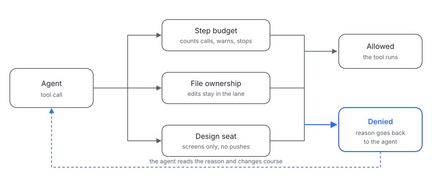

# agent-guardrails

Three Claude Code hooks and one CLI that keep AI coding agents inside their limits when several run at once.



## Why this exists

Agents running in parallel spend money without limit. They edit each other's files. They pass tests that could never fail.

## What is included

| Piece | What it does |
| --- | --- |
| `hooks/step-budget.mjs` | Counts tool calls per agent, warns once, then stops everything but reads. |
| `hooks/file-ownership.mjs` | Gives each agent a lane of files and denies edits outside it. |
| `hooks/design-seat.mjs` | Limits a design agent to screen files and blocks pushes, pull requests and test runs. |
| `bin/planted-fault.mjs` | Breaks your code on purpose and checks that your test notices. |

Node 18 or newer. No dependencies. Works on Windows and POSIX.

## Quick start

Copy `hooks/` and `lib/` into your project. Put this in `.claude/settings.json` (also in `examples/settings.json`):

```json
{
  "hooks": {
    "PreToolUse": [
      {
        "matcher": "*",
        "hooks": [
          { "type": "command", "command": "node \"$CLAUDE_PROJECT_DIR/hooks/step-budget.mjs\"" }
        ]
      },
      {
        "matcher": "Edit|Write|NotebookEdit",
        "hooks": [
          { "type": "command", "command": "node \"$CLAUDE_PROJECT_DIR/hooks/file-ownership.mjs\"" }
        ]
      },
      {
        "matcher": "Edit|Write|Bash",
        "hooks": [
          { "type": "command", "command": "node \"$CLAUDE_PROJECT_DIR/hooks/design-seat.mjs\"" }
        ]
      }
    ]
  }
}
```

Add `.guardrails/owners.json` (see `examples/owners.json`), then start each agent with its own `GUARDRAILS_LANE`. When a hook denies a call, it prints this and exits 0:

```json
{"hookSpecificOutput":{"hookEventName":"PreToolUse","permissionDecision":"deny","permissionDecisionReason":"Lane \"api\" does not own src/web/app.js. Its files: src/api/**, test/api/**. Ask the agent that owns this path, or stay in your lane."}}
```

The agent sees the reason and can change course. An allowed call prints nothing.

If a hook gets input it cannot parse, or hits an error of its own, it allows the call and writes one warning line to stderr. A bug in a guard should never freeze a session.

## How each piece behaves

**Step budget.** The counter lives in a JSON file under `os.tmpdir()/agent-guardrails/`, keyed by `agent_id`, or by `session_id` when there is none. Past `GUARDRAILS_STEP_WARN` (default 120) one call is denied with a request to write a hand-off note. Past `GUARDRAILS_STEP_LIMIT` (default 150) only Read, Grep and Glob pass. Delete the file to reset a count. `GUARDRAILS_STATE_DIR` moves it.

**File ownership.** Lanes are glob lists in `.guardrails/owners.json` in the project folder. `*` matches inside one path segment and `**` matches across segments. The agent's lane comes from `GUARDRAILS_LANE`. Edit, Write and NotebookEdit are checked. Backslashes become slashes, relative paths resolve against `cwd`, and any path that climbs out of the project with `..` is denied. No owners file, or no lane set, allows everything. A lane name missing from the file owns nothing.

**Design seat.** Active only when `GUARDRAILS_SEAT=design`. Edit and Write are denied under `api/`, `server/`, `db/`, `migrations/`, `scripts/`, `test/` and `tests/`, and on `*.test.*` and `*.spec.*` files. Bash is denied for `git push`, `gh pr`, `npm test`, `node --test` and `playwright test`. Everything else passes.

**Planted fault.** A passing test only counts if it can fail. This command swaps one piece of code for a broken one and runs your test:

```
planted-fault --file src/x.js --find "a + b" --replace "a - b" --test "node --test test/x.test.mjs"
```

It first checks that the test passes (exit 2 if not), then that `--find` matches exactly once (exit 2 if not). It applies the change, runs the test again, and restores the file byte for byte in a `finally`, including on Ctrl-C. It prints `CAUGHT: the test failed on the planted fault` and exits 0, or `MISSED: the test still passes with the fault in place` and exits 1.

## Tests

```
node --test
```

The suite covers each hook's allow and deny paths, malformed input, and runs each script as a child process. The planted-fault tests check that the file is restored after every outcome. Running `planted-fault` against `hooks/file-ownership.mjs` with its allow check inverted reports CAUGHT.

## License

MIT. See `LICENSE`.

These are written from scratch, based on how we build Awnitboss, which is closed source and contributes no code here.
